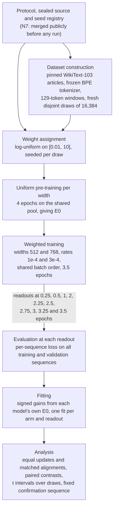
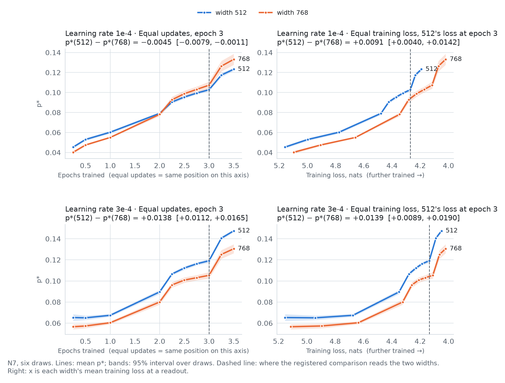
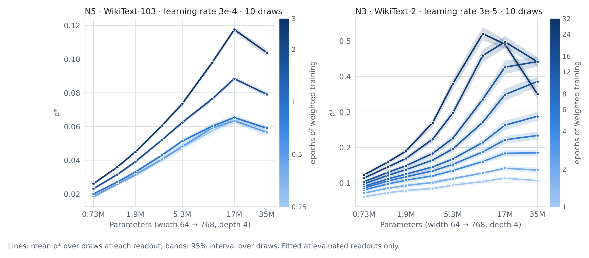
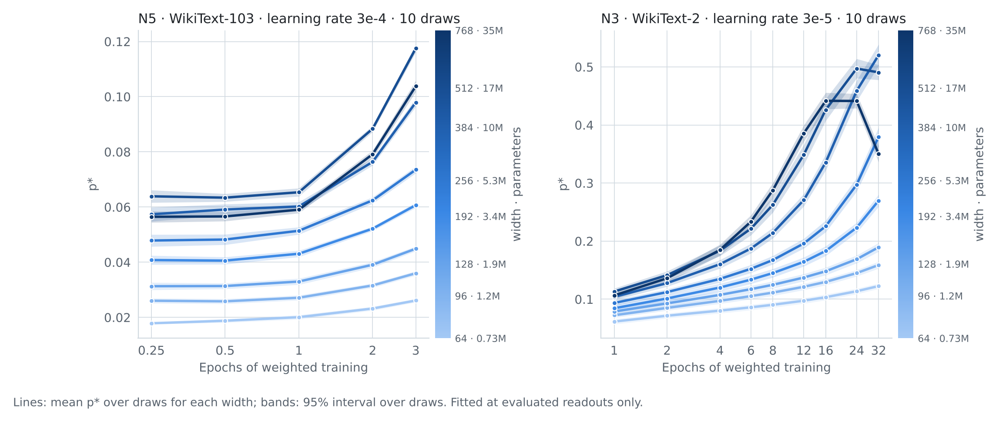
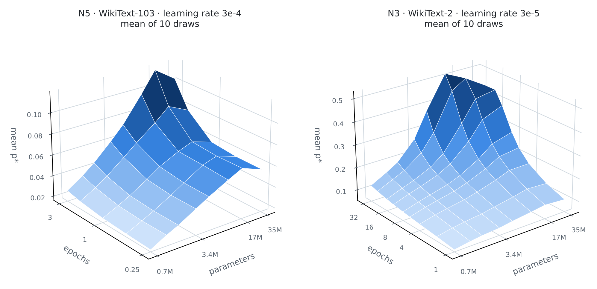
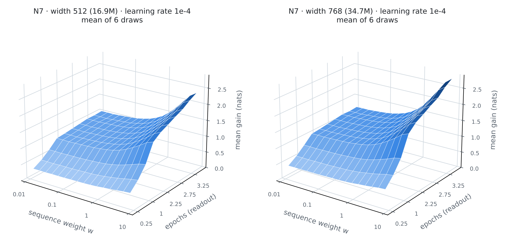
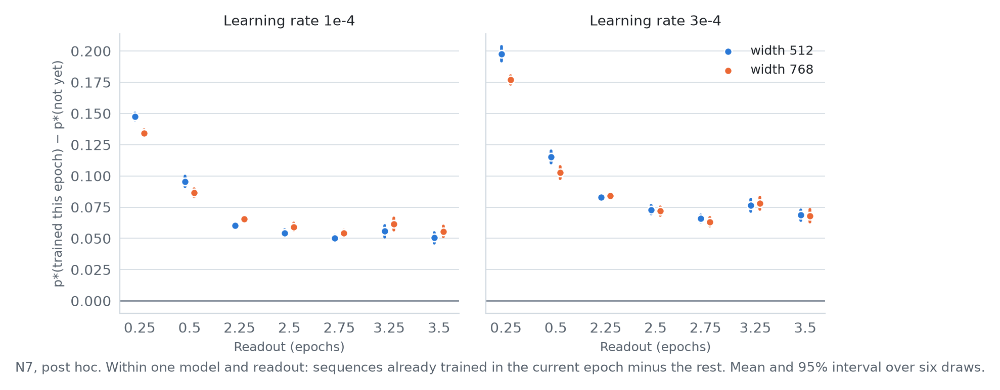
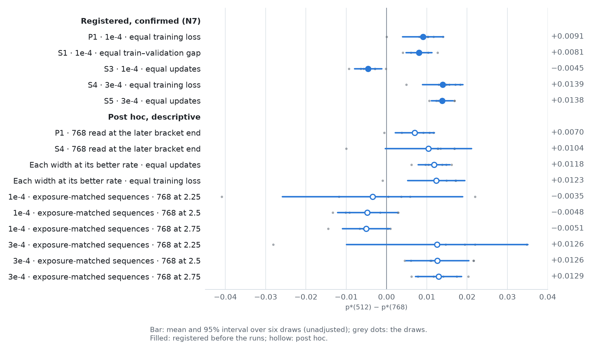

# Methods

This document describes how the studies were run and analysed: data, models, training, the estimator, the
alignments compared, interpolation and statistics. It describes N7, the publicly preregistered study, unless a section
says otherwise. Whatever this page says, the sealed protocol and source code of each study take precedence; they are
linked in [`NATURAL_TEXT_STUDIES.md`](NATURAL_TEXT_STUDIES.md). Current claims are in
[`CURRENT_CLAIMS.md`](CURRENT_CLAIMS.md).

## 1. Studies and how each was registered

| Study | Data | Widths | Learning rate | Weighted epochs | Draws | Registration |
|---|---|---|---|---|---|---|
| S | synthetic task | 32–384 (8 widths) | 1e-4 | 40, analysed from 15 | 12 corpora | sealed by hash within the project |
| N1 | WikiText-2 | 64–384 | selected per width | 32 | 10 | sealed by hash within the project |
| N3 | WikiText-2 | 64–768 | 3e-5 | 32 | 10 | sealed by hash within the project |
| N4 | WikiText-2 | 256–768 | 3e-5 | 32 | 4 | sealed by hash within the project |
| N5 | WikiText-103 | 64–768 | 3e-4 | 3 | 10 | sealed by hash within the project |
| N6 | WikiText-103 | 512, 768 | 1e-4, 3e-4 | 3 | 6 | registered publicly after its data existed (merge commit `58240f0`, 3 Nov 2026) |
| N7 | WikiText-103 | 512, 768 | 1e-4, 3e-4 | 3.5 | 6 | registered publicly before any run (merge commit `f3a2571`, 5 Nov 2026) |

"Sealed by hash within the project" means the protocol and source were hashed and frozen before the runs, but not
published until later. The whole record was published retrospectively; version 1.0 was released on 9 November 2026.
How to check the two public registrations against the archived commits is in
[`NATURAL_TEXT_STUDIES.md`](NATURAL_TEXT_STUDIES.md).

## 2. Data, splits and overlap

- **Text.** WikiText-2 and WikiText-103 rows from the Hugging Face dataset `Salesforce/wikitext`, pinned by revision
  and hash ([`DATA_AVAILABILITY.md`](DATA_AVAILABILITY.md)). Rows are grouped into articles.
- **Tokenizer.** A byte-level BPE tokenizer with 4,096 tokens, trained once on WikiText-2's training rows
  (`tokenizers` 0.21.4) and then frozen; the WikiText-103 studies reuse it unchanged. The tokenizer file is not
  published. Its settings are in the sealed `text_plan.py` and its SHA-256 in `acquire_plan.py`
  (`cd642ca2…`). The sealed data check (`text_data.py`) refuses a corpus manifest that does not record two
  identical trainings of the tokenizer.
- **Sequences.** Each article is tokenized separately and cut into non-overlapping windows of 129 tokens (128 inputs,
  128 next-token targets); remainders are dropped.
- **Corpus.** The WikiText-103 studies draw from WikiText-103 training articles, excluding every article equal by
  title or text to a WikiText-2 article (N5's corpus rule, `fewepoch_analysis.DISCLOSURE`).
- **Draws (N7).** Six draws, m01–m06, of 16,384 sequences each. Articles used by any earlier WikiText-103 study
  (N5's t00–d10, N6's c01–c06), text duplicates of those articles, and texts repeated inside the pool are excluded
  before partitioning; each partition is re-derived and checked against its pinned hash
  ([protocol §2](preregistration/natural-text-matched-confirmation-20261104/sealed-source/PROTOCOL.md)).
- **Shared sets.** The 512 validation sequences are stride-selected from WikiText-2's validation rows, and the uniform
  pre-training pool (at most 2,048 sequences) from its test rows, both pinned by hash in `text_plan.py`. Both are
  shared by every draw and study, as is the tokenizer. Because the test rows are the pre-training pool, there is no
  held-out test loss.
- **Tuning.** N7 chose no rate: 3e-4 is the rate N5 selected on its tuning draw t00, and 1e-4 is width 768's lowest
  validation loss among five rates on t00. t00's articles are excluded from N7's draws.

The record checks overlap only through these exclusion rules and pinned partitions. It reports no other leakage
analysis.

## 3. Model and training

| Item | Setting (N7) | Source |
|---|---|---|
| Architecture | Decoder-only Transformer, pre-LayerNorm blocks, causal attention, learned position embeddings, final LayerNorm, untied output layer without bias, no dropout | [`text_model.py`](preregistration/natural-text-matched-confirmation-20261104/sealed-source/text_model.py) |
| Depth and heads | 4 layers, 4 heads at every width, so the head dimension is width / 4 (128 at width 512, 192 at width 768) | `text_plan.py` |
| Changes with width | Embedding size, head dimension and the feed-forward size (4 × width) | `text_model.py` |
| Context and vocabulary | 128 positions; 4,096 tokens | `text_plan.py` |
| Parameters | width 512: 16,870,400; width 768: 34,742,784 (exact counts from `text_plan.parameters`) | `text_plan.py` |
| Initialisation | Normal(0, 0.02) for linear and embedding weights; zero biases | `text_model.py` |
| Pre-training (gives E0) | Uniform weights, 4 epochs on the shared pool, AdamW at 3e-4, weight decay 0.1, gradient clipping at norm 5 | `text_plan.py`, `text_worker.py` |
| Weighted training | AdamW (PyTorch defaults otherwise), fresh optimiser state, constant learning rate 1e-4 or 3e-4, weight decay 0.1, batch 16, 3.5 epochs (3,584 updates), clipping of the global gradient norm at 1 | `text_plan.py`, `text_worker.py`, `matched_worker.py` |
| Weighted loss | Mean over the batch of $w_i \ell_i$, where $\ell_i$ is the sequence's mean next-token loss; not divided by the batch's weight sum | `text_worker.adaptation_step` |
| Weights | Drawn log-uniform on $[0.01, 10]$ from the draw's registered seed, then divided by their mean over the draw; at most one tied value per 1,024 sequences. p\* does not change when all weights are scaled by a constant | `text_engine.weights` |
| Batch order | A fresh permutation per epoch from the draw's order seed (`randperm` seeded with 999 + order seed + epoch); every arm of a draw uses the same order | `text_engine.orders` |
| Readouts | E0, then 0.25, 0.5, 1, 2, 2.25, 2.5, 2.75, 3, 3.25 and 3.5 epochs | `matched_plan.py` |
| Evaluation | After each readout's update, a separate pass in evaluation mode without gradients computes every training and validation sequence's mean next-token loss | `text_engine.evaluate` |
| Hardware and software | One NVIDIA GeForce RTX 3050 Laptop GPU (4 GB); Python 3.12.3, PyTorch 2.7.0+cu126, cuDNN 9.5.1 (full package lock in `ORIGINAL_ENVIRONMENT.json`). cuDNN benchmarking and TF32 off; deterministic algorithms not enforced | `text_framework_setup.py`, `ORIGINAL_ENVIRONMENT.json` |

**Clipping.** `clip_grad_norm_` rescales the whole update whenever the norm of the summed gradient exceeds 1; in N7
this happened on 92–99% of updates. A sequence's effect on an update therefore depends on the gradients of the other
sequences in its batch. This is not the same as dividing the weights by their batch sum, and the record does not
estimate how much it shapes p\*. Post hoc, a sequence's loss drop in N7 rises with its own weight and falls, by a
similar amount, with its 15 batch-mates' summed weight
([follow-up audit](reports/follow-up-audit-20261112-01/REPORT.md), AA-2).

## 4. The estimator

### Definition

For one draw, model, learning rate and readout, let $g_i = \ell_i^{(\mathrm{E0})} - \ell_i^{(t)}$ be the signed gain of
sequence $i$, measured from that model's own E0. Order the $n$ sequences by weight, $w_{(1)} \le \dots \le w_{(n)}$,
and define

```math
\tilde g_{(i)} = \frac{g_{(i)}}{\sum_{j} g_j}, \qquad
\tilde w_{(i)}(p) = \frac{w_{(i)}^{\,p}}{\sum_{j} w_j^{\,p}}, \qquad
C_k(p) = \sum_{i=1}^{k} \left( \tilde g_{(i)} - \tilde w_{(i)}(p) \right).
```

The reported value is the minimiser of the mean squared cumulative discrepancy,

```math
\hat p^{\ast} = \underset{p \in [0,\,8]}{\arg\min} \; \frac{1}{n} \sum_{k=1}^{n} C_k(p)^2 .
```

The gains are signed, so $\tilde g$ can contain negative entries; it is a normalisation, not a probability
distribution. This page writes $\hat p^{\ast}$ for the value fitted to a finite set of sequences and $p^{\ast}$ for the
quantity it targets, the exponent this objective would select for the model's expected gains over the weight
distribution. The rest of the record writes p\* for both.

The objective is the one in the reference study's
[technical note](https://blog.janestreet.com/a-study-of-sequence-weighting-at-scale/sequence-weighting-note.pdf), which
writes it as a quadratic form in the difference vector. The sealed implementation is
[`vendor/core.py`](preregistration/natural-text-matched-confirmation-20261104/sealed-source/vendor/core.py).

| Choice | Rule |
|---|---|
| Search | grid on [0, 8] with step 0.05, then 50 ternary steps between the neighbours of the best grid point; the result is the best of that point, 0 and 8 |
| Constant weights | undefined (`constant_weights`) |
| Total gain at most $10^{-10}$ | undefined (`nonpositive_total_gain`); individual negative gains are kept |
| Boundary fits | flagged at $\ge 7.999$ and refitted with the upper bound at 32 in a registered sensitivity analysis; a fit at 0 is reported as 0 |
| Ties | stable sort: tied weights keep their sequence order |

**Checks run on this implementation.** [`core_checks.py`](outputs/sequence-weighting-pilot/core_checks.py) confirms
that the cumulative form equals the quadratic form (largest absolute difference $4.9 \times 10^{-20}$), recovers
exponents 0, 0.5, 1 and 2 from gains proportional to $w^p$ (to within $10^{-11}$), and checks the handling of constant
weights and non-positive total gain. [`tools/verify_n7_losses.py`](tools/verify_n7_losses.py) is an independent NumPy
implementation; it refits all 240 N7 estimates from the released losses and matches the published values within
$10^{-6}$.

### What the fitted exponent measures

$\hat p^{\ast}$ summarises how the total loss reduction is allocated across sequence weights, under this objective. It
is not a derivative of the loss with respect to the weight, and it is not a property of a model apart from its
training run, baseline and weight distribution.

- **A fit of 0** does not show that gains are independent of the weights: the search is constrained to $p \ge 0$, so
  gains that fall with the weight also fit at 0.
- **A fit of 1** does not show exact proportionality when gains are not a power of the weight.
- **Misspecification.** Suppose gains followed $g(w) = a + b\,w^{q}$. Increasing the weight-independent part $a$ moves
  the normalised gains towards uniform and pulls the fitted exponent towards 0, even though $q$ is unchanged. This is a
  property of the summary, offered as a conceptual example, not a mechanism observed in these experiments. The N7
  gains are not a power of the weight: at epoch 3, mean gain is nearly flat over the lower half of the weights and
  rises over the upper half (descriptive figure 4 below; follow-up audit, AA-6).

### Fit diagnostics in the record

[`FITS.csv`](reports/natural-text-matched-analysis-20261105-01/FITS.csv) stores, for each of N7's 240 fits, the
objective at the fit and at $p = 0$ (`objective`, `J0`), the fraction of sequences with negative gain, the total gain,
and the bound flags. Over N7 (post-hoc descriptive summary of the published table,
[`describe_fits.py`](reports/readme-revision-20261113-01/describe_fits.py)):

- fitted values range from 0.038 to 0.149; no fit is at either bound and none is undefined;
- the objective at the fit is 3–8% of its value at $p = 0$ (median 5%);
- negative gains occur for 0–3.9% of sequences, and the smallest total gain is 6,027 nats summed over 16,384 sequences.

Gain-by-weight curves are in figure 4. No goodness-of-fit test is defined in the protocol, and none is reported.

## 5. Alignments and baselines

Each model's gains are measured from its own E0. After the same pre-training, width 768 starts from a higher E0 loss
than width 512 (by 0.037 nats on average; follow-up audit, AA-3), so equal final training loss does not mean equal
initial loss, equal total improvement, equal learning history or equal exposure. Lowering 768's gains by that offset
moves P1 to +0.0062 [−0.0001, +0.0126] (`CURRENT_CLAIMS.md`, C4).

The record compares widths under four operational alignments. Each fixes one quantity; none fixes training progress
in general.

| Alignment | What is held equal | Registered statistic (N7) |
|---|---|---|
| Equal updates | Number of updates, hence tokens seen and their order (same batch size and context); not compute | S3 (1e-4), S5 (3e-4) |
| Equal training loss | Mean unweighted training loss over the draw's sequences | P1 (1e-4, primary), S4 (3e-4) |
| Equal train–validation gap | Validation minus training loss | S1 (1e-4) |
| Equal validation loss | Mean validation loss | S2 (1e-4) |

In every matched alignment, width 512 is read at epoch 3 and width 768 is read where it reaches 512's value.

**Exposure.** At equal training loss, 768 is read part-way through its third epoch (epochs 2.19–2.48 in P1) while 512
is read at the end of its third. The two models have therefore trained on different shares of the current epoch's
sequences, and sequences trained within the current epoch have a higher fitted exponent than the rest by 0.05–0.08
(post hoc). That makes exposure an alternative explanation for part of the equal-loss contrast; the analyses do not
establish how much, and a subgroup difference within one model cannot be subtracted from a contrast between models.

**Exposure-matched comparison (post hoc).** Batch orders are regenerated from the seeds. For 768 read at epoch 2 + k/4,
the matched set is the sequences trained in quarters 1..k of each of epochs 1–3; for 512 at epoch 3, those trained in
quarters 5−k..4, so that every pass is equally long ago in both. The two models' sets are different sequences. Script
and per-draw values:
[`natural-text-matched-assistant-posthoc-20261111-01`](reports/natural-text-matched-assistant-posthoc-20261111-01/REPORT.md).

Set sizes and weight distributions (post hoc, 13 November;
[`matched_set_weights.py`](reports/readme-revision-20261113-01/matched_set_weights.py)):

| k | 768 read at | Sequences per set | Largest difference in median log10 weight, set − whole draw |
|---|---|---|---|
| 1 | epoch 2.25 | 226–272 | 0.127 |
| 2 | epoch 2.5 | 2,018–2,116 | 0.037 |
| 3 | epoch 2.75 | 6,883–6,931 | 0.022 |

Batch orders do not depend on the weights, so each set's weights are a random sample of the draw's; the larger
differences at k = 1 are what sets of about 250 give. Small sets make the estimates noisy: two random disjoint subsets
of the k = 1, 2 and 3 sizes in one model differ in p\* with SDs of 0.0155, 0.0050 and 0.0028 (follow-up audit, AA-1).
The matched sets are not matched on training loss: the two models' losses on them differ by 0.04–0.11 nats, with 512
behind at k = 2 and 3 (`CURRENT_CLAIMS.md`, C4).

## 6. Interpolation

The quantity interpolated is the **fitted exponent** of width 768, linearly in training loss (or gap, or validation
loss) between the two readouts that bracket 512's epoch-3 value, along 768's readouts from epoch 2 to 3.5. No losses
are interpolated and no exponent is fitted to interpolated gains; the two would generally differ, because $\hat p^{\ast}$
is not linear in the gains. An interpolated value is an estimate between two measured checkpoints, not a measurement.

Rules fixed in the protocol (§4): the reading comes from the first interval in readout order whose two values hold the
target, and the number of such intervals is reported (the path need not be monotone); a target equal to a readout's
value is held by the first interval containing it; an interval with two equal values equal to the target is read at
its earlier readout; a target outside the epoch 2–3.5 path makes the draw unavailable for that statistic. Each draw's
bracket, weight and read position are in
[`MATCHED.csv`](reports/natural-text-matched-analysis-20261105-01/MATCHED.csv).

Unavailable draws are not a random subset: whether 768 reaches the target inside the path depends on its training
trajectory. S2 lost three of six draws this way.

The sensitivity analyses read 768 at the later end of each bracket instead of interpolating. Since the fitted exponent
mostly rises inside a bracket, this shows how the contrast moves if the true value lies near that end; it is not a
bound on the unobserved trajectory.

## 7. Statistics

- **Unit of replication.** The draw. Each draw is one set of articles, weights and seeds, trained once per arm.
  Sequences within a draw and repeated readouts of one run are not independent replications.
- **Pairing.** Contrasts are computed within a draw (same sequences, weights and batch order) and then summarised over
  draws.
- **Intervals.** Two-sided 95% t intervals over the six draws (df = 5, t = 2.5706). They cover variation in what was
  varied across draws (articles, weights and seeds), conditional on everything shared: tokenizer, pre-training pool,
  validation set, recipe and hardware. Normality is assumed, not tested.
- **Sign tests.** Exact two-sided sign tests are reported beside each interval; with six draws the smallest possible
  p-value is 0.031.
- **Fixed sequence.** P1 → S1 → S3 → S4 → S5 → S2: a step is read as a confirmation only while every earlier step is
  confirmed. The protocol's simulation gives a 2.5% chance of any false confirmation (5% counting errors on either
  side), assuming valid constituent tests and the registered order.
- **Leave-one-draw-out** intervals are reported for every statistic.
- **Figure bands** are pointwise 95% intervals at each readout, not simultaneous bands.
- **Post-hoc analyses** are descriptive; their intervals are unadjusted for multiplicity and for the choices made after
  the data were known. The power figures quoted for the exposure-matched comparison assume a true effect equal to P1's
  mean (+0.0091), the observed between-draw SD as the true SD, and a two-sided t test at df = 5; low power means the
  comparison could not detect an effect of that size, not that the effect is absent.
- **Scale of the effects.** A contrast in p\* is a difference in a fitted exponent, not a change in model performance.
  P1's +0.0091 compares with a mean fitted value of 0.103 for width 512 at epoch 3 at 1e-4, and 0.09–0.10 for 768
  where it is read.

## 8. Comparison with the reference study

[A study of sequence weighting at scale](https://blog.janestreet.com/a-study-of-sequence-weighting-at-scale/) (Alex
Renda and Nitya Mani, Jane Street, 14 September 2026) reports that p\* rises and then falls with model size, and that
"training for more epochs shifts the peak towards smaller model scales". The epoch-dependent movement of the peak is
therefore the reference study's finding; the earlier studies here (C1) are consistent with it in sign at small scale.
This record's own contribution is the comparison of alignments in N7.

| | Reference study (as described in the post) | This record |
|---|---|---|
| Models | In-house pretrained dense (9 models) and mixture-of-experts (8 models) families from tens of millions to hundreds of billions of parameters, and the open Qwen 2.5 family (0.5 B–72 B) | Width 64–768 at depth 4: 0.73 M–34.7 M parameters |
| Data | An internal text benchmark | WikiText-2, WikiText-103 |
| Training | Models "in-house pretrained", then trained on the weighted data for 3 epochs and evaluated after each; pre-training details not given | Uniform pre-training on a shared pool, then 3–32 epochs of weighted training |
| Hyperparameters | Tuned to minimise validation loss; a Chinchilla-style scaling law for the largest in-house models | Constant learning rate; the widths in a comparison share one rate |
| Alignment of sizes | Not stated | The object of study |
| Seeds and intervals | Not stated | 4–10 draws per study; t intervals over draws |
| Weights and estimator | Log-uniform on [0.01, 10]; the technical note's estimator | The same |

## 9. Pipeline



Evaluation is per sequence: no weight buckets are formed for the fits. Groupings by weight appear only in descriptive
figures.

## 10. Descriptive figures

These figures summarise published tables and the released N7 losses. They test no hypothesis. Bands are pointwise 95%
t intervals over draws. Each figure is drawn by [`docs/make_results_figures.py`](docs/make_results_figures.py) or
[`docs/make_readme_figures.py`](docs/make_readme_figures.py); the `.html` files are interactive versions.

**Figure 1.** N7: fitted exponent of each width against epochs and against training loss.

<picture>
  <source media="(prefers-color-scheme: dark)" srcset="docs/figures/alignment-dark.png">
  
</picture>

*At 1e-4 the order of the two widths depends on the axis; at 3e-4 it does not. Dashed lines mark where the registered
comparisons read the widths. On the right, the x-coordinate is each width's mean training loss at a readout; the
registered matching is done per draw. Mean over six draws.*

**Figure 2.** N5 and N3: fitted exponent against parameters, one line per readout.

<picture>
  <source media="(prefers-color-scheme: dark)" srcset="docs/figures/pstar-vs-size-dark.png">
  
</picture>

*At each evaluated readout, the width with the highest mean exponent has 1.8–4.5 times the value at width 64. On
WikiText-103 (N5, 3e-4) the highest value is at width 512 at every readout. On WikiText-2 (N3, 3e-5) it is at 512 for
epochs 1–2, at 768 for epochs 4–16, at 512 at epoch 24 and at 384 at epoch 32. Mean over 10 draws. Interactive:
[`pstar-vs-size.html`](docs/figures/pstar-vs-size.html).*

**Figure 3.** The same data against training time, one line per width, and as surfaces.

<picture>
  <source media="(prefers-color-scheme: dark)" srcset="docs/figures/pstar-vs-training-dark.png">
  
</picture>

<picture>
  <source media="(prefers-color-scheme: dark)" srcset="docs/figures/pstar-surface-dark.png">
  
</picture>

*Every width's mean exponent is higher at its last readout than at its first, but not every path rises throughout. On
WikiText-2, width 768 is flat from epoch 16 to 24 and falls from 0.44 to 0.35 by epoch 32, and 512 falls slightly from
24 to 32; on WikiText-103, widths 96, 192 and 512 dip by at most 0.0005 between the first two readouts. Interactive:
[`pstar-surface.html`](docs/figures/pstar-surface.html).*

**Figure 4.** N7: mean gain by sequence weight and readout.

<picture>
  <source media="(prefers-color-scheme: dark)" srcset="docs/figures/gain-by-weight-dark.png">
  
</picture>

*Mean gain in 16 equal bins of log weight, averaged over 6 draws × 16,384 sequences at 1e-4. At epoch 3, width 512
gains about 1.05 nats in the lightest bins and 2.1 nats in the heaviest; the curve is nearly flat over the lower half of
the weights. Width 768 gains more in every bin at every readout; part of that difference is its higher E0. Interactive:
[`gain-by-weight.html`](docs/figures/gain-by-weight.html).*

**Figure 5.** N7: fitted exponent of sequences trained in the current epoch minus that of the rest (post hoc).

<picture>
  <source media="(prefers-color-scheme: dark)" srcset="docs/figures/exposure-dark.png">
  
</picture>

*Within one model and readout, the sequences already trained in the current epoch have a higher fitted exponent than
the rest. This is a difference between subgroups of one model, not a decomposition of the cross-width contrast.*

**Figure 6.** Every estimate of the 512 − 768 contrast.

<picture>
  <source media="(prefers-color-scheme: dark)" srcset="docs/figures/estimates-dark.png">
  
</picture>

*Filled: registered before the runs; hollow: post hoc and unadjusted. Grey dots: the six draws.*
