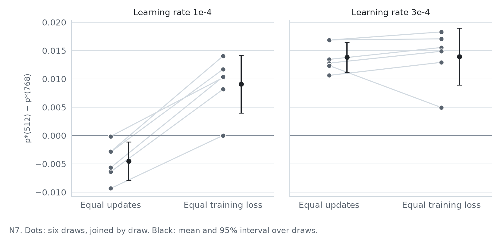

# Sequence weighting across model widths

When each training sequence carries a weight in the loss, the fitted exponent p\* summarises how a model's loss
reduction is allocated across those weights. This record asks a narrow question about comparing p\* across model
sizes: **does the order of two widths depend on how they are aligned, at equal updates or at equal training loss?** It
contains small decoder-only Transformers (0.73 M–34.7 M parameters) trained on WikiText-2 and WikiText-103, and one
study, N7, whose protocol was published before any of its runs. Beside it is N8, a dense-readout replication of
N7: its protocol and sealed source were registered publicly before any of its runs; its runs have not started, and it
has no results yet.

**Status:** research record. It was closed after N7 and reopened on 14 November 2026 for one registered study, N8
([preregistration](preregistration/natural-text-dense-replication-20261114/README.md)). Latest release:
[v2.0](https://github.com/rafli-hl/sequence-weighting/releases/tag/v2.0) (15 November 2026). The README
and methods were revised on 13 November 2026; no result, label or sealed file changed
([`PUBLICATION_NOTES.md`](PUBLICATION_NOTES.md)).

[Current claims](CURRENT_CLAIMS.md) · [Methods](METHODS.md) · [Studies](NATURAL_TEXT_STUDIES.md) ·
[N7 preregistration](preregistration/natural-text-matched-confirmation-20261104/README.md) ·
[N7 result](reports/natural-text-matched-result-20261105-01/RESULT.md) · [N8 preregistration](preregistration/natural-text-dense-replication-20261114/README.md) ·
[Data availability](DATA_AVAILABILITY.md)

## Main finding

In N7 (widths 512 and 768, WikiText-103, six draws, width 512 read at epoch 3), at learning rate 1e-4 the contrast
p\*(512) − p\*(768) is **below 0 at equal updates** (−0.0045 [−0.0079, −0.0011]) and **above 0 at equal training
loss** (+0.0091 [+0.0040, +0.0142]). Both registered intervals exclude 0. At 3e-4, 512 is above 768 under both
alignments.

This shows that the comparison axis can change the sign of a cross-width contrast in p\*, for this pair of widths and
this training configuration. It does not show that 512 has the higher p\* once training progress is matched. At equal
training loss the two models have trained on different shares of the current epoch, and post-hoc comparisons on
sequences matched for training exposure are inconclusive. The equal-updates result is sensitive to which draws are
included, and the order depends on the learning rate. Details are next to the table below.

The reference study ([Renda and Mani, 2026](https://blog.janestreet.com/a-study-of-sequence-weighting-at-scale/))
already reports that p\* rises and then falls with model size and that "training for more epochs shifts the peak
towards smaller model scales". This record does not claim that finding as new. Its own contribution is the registered
comparison of alignments, at a far smaller scale.

<picture>
  <source media="(prefers-color-scheme: dark)" srcset="docs/figures/result-dark.png">
  
</picture>

*N7, the registered contrasts. Each grey line joins one draw's contrast at equal updates to its contrast at equal
training loss; black: mean and 95% t interval over the six draws. At 1e-4 every draw is below 0 at equal updates and
above 0 at equal training loss, but two draws are close to 0 (m02 at −0.00014 and m06 at +0.00002). The equal-loss
values interpolate 768's fitted p\* between readouts; they are not measured at a checkpoint.*

## Key results

Registered contrasts of N7, p\*(512) − p\*(768), read in the registered order P1 → S1 → S3 → S4 → S5 → S2. Mean
and two-sided 95% t interval over six draws (df = 5), and the number of draws above 0.

| Step | Rate | Alignment | Contrast | Above 0 | Label |
|---|---|---|---|---|---|
| **P1** (primary) | 1e-4 | equal training loss | +0.00909 [+0.00400, +0.01417] | 6/6 | REVERSAL_CONFIRMED |
| S1 | 1e-4 | equal train–validation gap | +0.00808 [+0.00487, +0.01130] | 6/6 | CONFIRMED |
| S3 | 1e-4 | equal updates | −0.00454 [−0.00795, −0.00114] | 0/6 | CONFIRMED (predicted below 0) |
| S4 | 3e-4 | equal training loss | +0.01394 [+0.00893, +0.01896] | 6/6 | CONFIRMED |
| S5 | 3e-4 | equal updates | +0.01382 [+0.01116, +0.01648] | 6/6 | CONFIRMED |
| S2 | 1e-4 | equal validation loss | — | — | UNAVAILABLE: 3 of 6 draws had a reading; 5 were required |

Sensitivity of the same contrasts. Leave-one-draw-out intervals were registered; reading 768 at the later end of each
interpolation bracket, instead of interpolating, was added in the [9 November correction](reports/natural-text-correction-20261109-01/CORRECTION.md)
(post hoc).

| Step | Leave-one-draw-out (registered) | 768 at the later bracket end (post hoc) |
|---|---|---|
| P1 | above 0 with any one draw left out | +0.00702 [+0.00216, +0.01189] |
| S1 | above 0 with any one draw left out | +0.00399 [+0.00099, +0.00699] |
| S3 | **includes 0 without m03 or without m05** | not interpolated |
| S4 | above 0 with any one draw left out | **+0.01043 [−0.00027, +0.02113], includes 0**; draw m06, read at epoch 3.08, decides it |
| S5 | above 0 with any one draw left out | not interpolated |

**How to read the labels.** A step is CONFIRMED when its interval lies on the predicted side of 0 and every earlier
step in the sequence is confirmed; this holds the chance of any false confirmation at about 2.5% under the protocol's
assumptions. REVERSAL_CONFIRMED is P1's label for the same condition: its interval lies above 0 with at least five
draws. The label is determined by P1 alone. The opposite order at equal updates is S3's separate result, so the change
of sign at 1e-4 rests on P1 and S3 together, and S3 is the less robust of the two. By readout, the equal-updates
contrast at 1e-4 is above 0 at epochs 0.25–1 and below 0 only from epoch 2.5. With six draws, the exact sign test
for 6/6 gives p = 0.031.

**What else bears on these numbers** (post hoc unless stated; descriptive and unadjusted for multiplicity):

- **Starting points differ.** Gains are measured from each model's own state after uniform pre-training (E0), and
  768's E0 loss is 0.037 nats higher than 512's on average. Lowering 768's gains by that offset gives P1 = +0.0062
  [−0.0001, +0.0126], 5/6 ([follow-up audit](reports/follow-up-audit-20261112-01/REPORT.md), AA-3).
- **Weight range.** The signs of the five contrasts do not change on any weight sub-range tried, but on the lower half
  of the weights alone, where gains barely change with weight, P1 (+0.0012 [−0.0009, +0.0032]) and S4 include 0
  (AA-6).
- **Exposure differs at equal training loss.** P1 reads 768 at epochs 2.19–2.48, when it has trained on 19–48% of the
  draw a third time; 512 at epoch 3 has trained on all of it. Within one model, sequences already trained in the
  current epoch have p\* higher by 0.050–0.084 than the rest. This is an alternative explanation for part of P1; a
  difference between subgroups of one model cannot simply be subtracted from a contrast between models.
- **Exposure-matched comparisons at 1e-4 are inconclusive.** On sequences matched for the timing of all three passes,
  512 at epoch 3 against 768 at epochs 2.25, 2.5 and 2.75 gives −0.0035 [−0.0258, +0.0189], −0.0048
  [−0.0121, +0.0026] and −0.0051 [−0.0109, +0.0008]. The first, nearest to equal loss, uses about 250 sequences per
  model per draw and has power 0.14 for an effect of P1's size; the others are not matched on training loss. None of
  these establishes that the effect is absent. At 3e-4 the same comparisons are +0.0126 to +0.0129.
- **Learning rate.** Each comparison uses one rate for both widths, so it concerns that configuration, not equally
  optimised models. With each width at its better rate of the two (512 at 3e-4, 768 at 1e-4), 512 is above 768 at
  equal updates (+0.01184 [+0.00789, +0.01578]) and at equal training loss (+0.01235 [+0.00523, +0.01947]).
- **Scale of the effect.** P1 is a difference of 0.009 in a fitted exponent whose value for 512 at epoch 3 is 0.103.
  It is not a difference in model quality.

These analyses and their scripts are in
[`natural-text-matched-assistant-posthoc-20261111-01`](reports/natural-text-matched-assistant-posthoc-20261111-01/REPORT.md)
and [`CURRENT_CLAIMS.md`](CURRENT_CLAIMS.md) (claim C4).

**Earlier studies.** Five earlier studies (S, N1, N3–N5) had their protocols sealed by hash within the project before
their runs, but not published until later, and N6 was registered publicly after its data existed. Their claims C1–C3,
with the registered outcomes that did not confirm, are in [`CURRENT_CLAIMS.md`](CURRENT_CLAIMS.md). In brief: in the
evaluated readouts of N3 and N5, the width with the highest p\* has 1.8–4.5 times the p\* of width 64, and that width
changes with training time on WikiText-2 (figures in [`METHODS.md`](METHODS.md#10-descriptive-figures)).

## Setup

| | N7 |
|---|---|
| Data | WikiText-103 training articles; six fresh draws of 16,384 sequences of 129 tokens, disjoint from every earlier draw |
| Models | Pre-LayerNorm decoder-only Transformers, 4 layers and 4 heads at every width; embedding size, head dimension and feed-forward size grow with width. Width 512: 16,870,400 parameters; width 768: 34,742,784 |
| Training | Uniform pre-training on a shared pool (state E0), then weighted training: loss = batch mean of $w_i \ell_i$, AdamW, weight decay 0.1, batch 16, constant rate 1e-4 or 3e-4, gradient-norm clipping at 1, 3.5 epochs |
| Weights | Log-uniform on [0.01, 10] (rescaled to mean 1 per draw), the reference study's range |
| Readouts | E0, then 0.25, 0.5, 1, 2, 2.25, 2.5, 2.75, 3, 3.25 and 3.5 epochs; per-sequence loss on every training and validation sequence |

The full specification, including the data splits and overlap rules, is in [`METHODS.md`](METHODS.md). Two features
limit what the comparisons mean. Clipping rescales the summed gradient of each batch on 92–99% of updates, so a
sequence's influence depends on its batch-mates; this is not the same as dividing weights by their batch sum. And there
is no uniform-weight training arm: p\* can be estimated without one, but such an arm would be needed to separate the
effect of the weights from generic training, or to ask whether weighting helps performance.

### What p\* is

For one model at one readout, each sequence's gain is $g_i = \ell_i^{(\mathrm{E0})} - \ell_i^{(t)}$, signed. With the
sequences sorted by weight, the fitted exponent minimises the mean squared cumulative difference between the
normalised gains and the normalised powered weights:

```math
\hat p^{\ast} = \underset{p \in [0,\,8]}{\arg\min} \; \frac{1}{n} \sum_{k=1}^{n}
\Biggl( \sum_{i=1}^{k} \Bigl( \frac{g_{(i)}}{\sum_j g_j} - \frac{w_{(i)}^{\,p}}{\sum_j w_j^{\,p}} \Bigr) \Biggr)^{2} .
```

This is the objective of the reference study's
[technical note](https://blog.janestreet.com/a-study-of-sequence-weighting-at-scale/sequence-weighting-note.pdf),
implemented in [`core.py`](preregistration/natural-text-matched-confirmation-20261104/sealed-source/vendor/core.py).
The record writes p\* for the fitted value $\hat p^{\ast}$.

- It is a summary of where the loss reduction falls across weights under this objective, not a derivative of the loss
  with respect to the weight and not an intrinsic property of a model.
- A fit of 0 does not show that gains are independent of the weights (the search is constrained to $p \ge 0$), and a
  fit of 1 does not show exact proportionality: N7's gains are not a power of the weight.
- Gains are signed, so the normalised gains are not probability shares. A fit is undefined if all weights are equal
  or the total gain is at most $10^{-10}$; fits at the upper bound are flagged. None of N7's 240 fits is undefined or
  at a bound.

[`METHODS.md`](METHODS.md#4-the-estimator) gives the search, the guards, the checks of the implementation, the
available fit diagnostics and a conceptual example of how the fitted value can move without the underlying curvature
changing.

### Alignments

Each fixes one quantity and none fixes training progress in general. Width 512 is read at epoch 3.

- **Equal updates:** both widths after the same 3,072 updates, so the same tokens in the same order; not equal compute.
- **Equal training loss:** 768 read where its mean training loss equals 512's, found by linear interpolation of 768's
  fitted p\* between the two readouts that bracket that loss. Per-draw brackets are in
  [`MATCHED.csv`](reports/natural-text-matched-analysis-20261105-01/MATCHED.csv).
- **Equal train–validation gap** and **equal validation loss:** the same rule on those quantities.

Equal training loss does not mean equal starting loss, equal total improvement, equal learning history or equal
exposure.

## Reproducing the results

Tested in CI with Python 3.12. The first three steps need only the standard library.

```bash
git -c core.autocrlf=false clone https://github.com/rafli-hl/sequence-weighting.git
cd sequence-weighting
python tools/verify_publication.py                      # file integrity and local links
python outputs/sequence-weighting-pilot/core_checks.py  # estimator fixture; writes CORE_CHECKS.json beside it
```

`verify_publication.py` should report every manifest row exact and no unexpected broken link. `CORE_CHECKS.json`
should have `"status": "passed"`. On Windows, cloning without `core.autocrlf=false` changes line endings and the hashes.

**N7's primary contrast from the published table.** The example follows the registered reading rule: the first
bracketing interval in readout order, a flat interval read at its earlier readout, and a draw unavailable when the
target is outside 768's epoch 2–3.5 path.

```python
import csv, math, statistics as st

rows = csv.DictReader(open("reports/natural-text-matched-analysis-20261105-01/POINTS.csv"))
P = {(r["draw"], float(r["epoch"]), int(r["width"]), r["tag"]): r for r in rows}
draws, rate = sorted({k[0] for k in P}), "lr1e-04"
path = [e for e in sorted({k[1] for k in P}) if 2.0 <= e <= 3.5]

def read_768(target, d):  # 768's fitted p* where its training loss equals target
    pts = [(float(P[(d, e, 768, rate)]["train"]), float(P[(d, e, 768, rate)]["p"])) for e in path]
    for (x0, y0), (x1, y1) in zip(pts, pts[1:]):
        if min(x0, x1) <= target <= max(x0, x1):
            return y0 if x1 == x0 else y0 + (target - x0) / (x1 - x0) * (y1 - y0)
    return None  # target outside the path: the draw is unavailable

v = []
for d in draws:
    p768 = read_768(float(P[(d, 3.0, 512, rate)]["train"]), d)
    if p768 is not None:
        v.append(float(P[(d, 3.0, 512, rate)]["p"]) - p768)
assert len(v) >= 5, "fewer than five draws: P1 would be UNAVAILABLE"
half = 2.5706 * st.stdev(v) / math.sqrt(len(v))  # t(0.975, df = 5)
print(f"P1 = {st.mean(v):+.5f} [{st.mean(v) - half:+.5f}, {st.mean(v) + half:+.5f}], n = {len(v)}")
```

It prints `P1 = +0.00909 [+0.00400, +0.01417], n = 6`. The t value is for six draws.

**From the per-sequence losses.** The bundle `n7-loss-arrays-v1.zip` (SHA-256
`cbe26760e2062a4cf03307d779226fa6efce8cfcfbf57b2e092bd818af80b8a9`) is attached to the v1.2 release.

```bash
gh release download v1.2 --repo rafli-hl/sequence-weighting --pattern n7-loss-arrays-v1.zip
unzip n7-loss-arrays-v1.zip
pip install numpy
python tools/verify_n7_losses.py n7-loss-arrays       # refits all 240 estimates; prints PASS
pip install --index-url https://download.pytorch.org/whl/cpu torch==2.7.0
pip install -r tools/requirements-posthoc.txt
python tools/verify_posthoc.py n7-loss-arrays         # reruns the post-hoc exposure analysis; prints PASS
```

`verify_n7_losses.py` compares the refitted estimates with `POINTS.csv` (tolerance $10^{-6}$), mean losses with the run
records ($10^{-5}$) and the five confirmed contrasts with `ANALYSIS.json` ($10^{-6}$). `verify_posthoc.py` compares
every published post-hoc value with `RESULTS.json` ($10^{-6}$); it needs PyTorch 2.7.0 because it regenerates the batch
orders with `torch.randperm`. The figures are redrawn by `python docs/make_results_figures.py n7-loss-arrays` and
`python docs/make_readme_figures.py` (NumPy, SciPy, Matplotlib, Plotly).

## What is and is not reproducible

| Level | Status |
|---|---|
| 1. File integrity | Yes: `tools/verify_publication.py` checks every file against [`PUBLICATION_MANIFEST.csv`](PUBLICATION_MANIFEST.csv) |
| 2. Statistics from published tables | Yes, for every study: per-readout p\* and losses are in each analysis folder's `POINTS.csv` |
| 3. p\* from released losses | N7 only: from the v1.2 bundle. The earlier studies' per-sequence losses are not published |
| 4. Losses from model evaluation | No. Natural-text model states were hashed and deleted during the runs, and no model state of any study is published |
| 5. Training from scratch | Not demonstrated. Code, protocols, seeds, article partitions and data hashes are published, and WikiText is public. The blockers are practical: the corpus files and tokenizer must be rebuilt and checked against their pinned hashes; the sealed launcher and worker run only from the original machine's one-use activation folders and refuse any other GPU, PyTorch or cuDNN version, so they must be adapted; and deterministic algorithms were not enforced, so bit-identical losses are not expected even on the original hardware. No one has attempted it |

[`DATA_AVAILABILITY.md`](DATA_AVAILABILITY.md) lists what is published and what is not, and why.

## Main limitations

1. **Scale and architecture.** At most 34.7 M parameters, on one 4 GB laptop GPU. Width varies at fixed depth 4 and
   4 heads, so head dimension changes with width. The reference study's models span tens of millions to hundreds of
   billions of parameters; its regimes are not tested here.
2. **One recipe.** Batch 16, AdamW, constant learning rate, clipping at norm 1 and log-uniform weights on [0.01, 10].
   The level of p\* depends on these choices, and two rates were run with no width's best rate located.
3. **Alignment is not progress.** Every alignment fixes one quantity. At equal training loss inside an epoch, exposure
   differs between the models, and the exposure-matched comparisons have small sets and low power near equal loss.
4. **Interpolation.** Matched readings interpolate fitted p\* between readouts a quarter epoch apart. The later-end
   readings are a sensitivity check, not a bound on the unobserved trajectory. S4's sign depends on this.
5. **Few draws.** Six draws, df = 5, normality assumed. S3's interval includes 0 when one of two draws is left out.
   Intervals cover variation in articles, weights and seeds, not the shared tokenizer, pre-training pool, validation
   set or recipe.
6. **Registration.** Only N7 was publicly preregistered. N6 was registered publicly after its data existed; the other
   studies were sealed within the project, and their protocols and all results were published from 9 November 2026,
   after the runs.
7. **Post-hoc analyses** were chosen after the results were known; their intervals are not adjusted for that or for
   multiplicity.
8. **Review.** Reviews and audits in this record were carried out by AI systems. There has been no independent human
   review and no independent replication.

Open questions, and what would settle each, are in
[`CURRENT_CLAIMS.md`](CURRENT_CLAIMS.md#open-questions-and-what-would-settle-them).

## Further reading

| To find | Read |
|---|---|
| The current claims, their scope and the registered outcomes that did not confirm | [`CURRENT_CLAIMS.md`](CURRENT_CLAIMS.md) |
| Data, model, training, estimator, alignments, interpolation, statistics, figures | [`METHODS.md`](METHODS.md) |
| Every study, with protocols, results, tables and incidents | [`NATURAL_TEXT_STUDIES.md`](NATURAL_TEXT_STUDIES.md) |
| N7's registration, sealed source and seed registry | [`preregistration/natural-text-matched-confirmation-20261104/`](preregistration/natural-text-matched-confirmation-20261104/README.md) |
| N7's result, as written when the analysis ran | [`RESULT.md`](reports/natural-text-matched-result-20261105-01/RESULT.md) |
| The post-hoc exposure analysis | [`natural-text-matched-assistant-posthoc-20261111-01`](reports/natural-text-matched-assistant-posthoc-20261111-01/REPORT.md) |
| Audits and corrections | [8 November audit](reports/full-audit-20261108-01/AUDIT.md), [12 November audit](reports/follow-up-audit-20261112-01/REPORT.md); corrections of [9](reports/natural-text-correction-20261109-01/CORRECTION.md), [11](reports/natural-text-correction-20261111-01/CORRECTION.md) and [12 November](reports/natural-text-correction-20261112-01/CORRECTION.md) |
| What is published, and how this copy differs from the local record | [`DATA_AVAILABILITY.md`](DATA_AVAILABILITY.md), [`PUBLICATION_NOTES.md`](PUBLICATION_NOTES.md) |
| Map of the folders | [`reports/README.md`](reports/README.md), [`outputs/README.md`](outputs/README.md) and the table below |

| Path | Contents |
|---|---|
| `preregistration/` | Public registrations of N6 and N7, each with sealed source and seed registry |
| `work/*-source-*/` | Sealed protocols and source of S, N1 and N3–N5; `work/text-assets/` holds pinned dataset metadata |
| `reports/` | Seed registries, sealed analyses (`POINTS.csv`, `FITS.csv`, `MATCHED.csv`, `ANALYSIS.json`), results, reviews, audits, corrections |
| `outputs/`, `figure/`, `migration/` | Earlier synthetic-task studies, their figure catalogue, and an environment lock their scripts read |
| `docs/` | Figure scripts and figures, drawn from published tables and the N7 bundle |
| `tools/` | `verify_publication.py`, `verify_n7_losses.py`, `verify_posthoc.py`; run by the workflows in `.github/workflows/` |

Files whose hashes are cited elsewhere are never edited; corrections are dated notes. The history of this copy is in
[`PUBLICATION_NOTES.md`](PUBLICATION_NOTES.md).

### Where this record was built

This repository starts from a single commit of the finished record (version 1.2). The record was built in an earlier
repository, now private, whose full history, including the GitHub-signed commits that register N6 and N7, is archived at
[Software Heritage](https://archive.softwareheritage.org/browse/origin/?origin_url=https://github.com/rafli-hl/sequence-weighting-research).
Historical records link to the old repository; its pull requests are copied in
[`github-pr-snapshots-20261111-01`](reports/github-pr-snapshots-20261111-01/README.md) and
[`pr3-gh-snapshot-20261104`](reports/natural-text-peak-result-20261103-01/pr3-gh-snapshot-20261104/), and its commits
are at `https://archive.softwareheritage.org/swh:1:rev:<full commit hash>`.

## Citation

```bibtex
@misc{pratama2026sequenceweighting,
  author       = {Rafli Putra Pratama},
  title        = {Sequence weighting across model widths: research record},
  version      = {1.2},
  year         = {2026},
  howpublished = {\url{https://github.com/rafli-hl/sequence-weighting}}
}
```

## Licence

Code (`*.py`, `*.ps1`, `*.sh`, `*.ipynb`) is under the [MIT licence](LICENSE); everything else, including reports,
tables, figures and the loss-array bundle, is under [CC BY 4.0](LICENSE-CC-BY-4.0.md). Upstream assets keep their own
terms: WikiText-2 and WikiText-103 (Merity et al., 2017; Hugging Face dataset `Salesforce/wikitext`, recorded as
CC BY-SA 3.0 and GFDL) and, for Stage 1's public-text check, `EleutherAI/pythia-70m` (Biderman et al., 2023;
Apache-2.0). No model weights or dataset rows are included; see
[`DATA_AVAILABILITY.md`](DATA_AVAILABILITY.md#public-assets-and-their-terms).
