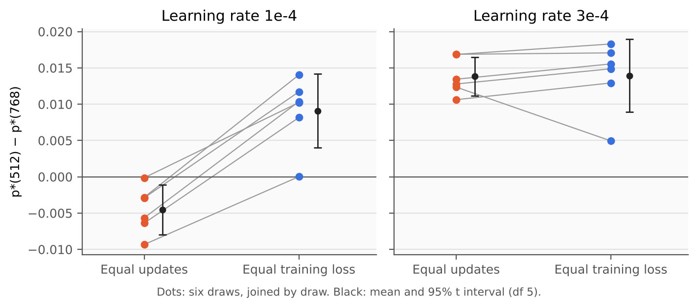

# Sequence weighting across model widths

This repository is the research record of a small-scale study of *sequence weighting*: giving each training sequence
a weight in the loss and measuring how strongly a model's learning follows those weights. It continues the question
raised by Renda and Mani's
[A study of sequence weighting at scale](https://blog.janestreet.com/a-study-of-sequence-weighting-at-scale/)
(Jane Street, September 2026). That study summarises the response with a fitted exponent, p\*, and reports that p\*
rises and then falls with model size.

Our main question is methodological. When p\* changes during training, models of different sizes compared after the
same number of updates are also at different stages of training. Does the ordering of sizes depend on how they are
aligned?

> [!NOTE]
> This is a closed research record, not a library. Models have at most 34.7 M parameters, and every result is a
> small-scale finding about the estimator p\*. Nothing here replicates or tests the regime of the reference study.
> The experiments are closed, and no further runs are authorised.

## Main result

In a confirmatory study (N7) registered publicly before any of its runs, we trained widths 512 and 768 on six fresh
WikiText-103 draws and compared p\* at epoch 3. The figure and table give p\*(512) − p\*(768), with 95% intervals over
draws.



| Learning rate | Equal updates (equal tokens) | Equal training loss |
|---|---|---|
| 1e-4 | −0.00454 [−0.00795, −0.00114], 0/6 positive | +0.00909 [+0.00400, +0.01417], 6/6 positive |
| 3e-4 | +0.01382 [+0.01116, +0.01648], 6/6 positive | +0.01394 [+0.00893, +0.01896], 6/6 positive\* |

\*Confirmed under the registered interpolation rule. Reading width 768 at the later end of each interpolation bracket
gives +0.01043 [−0.00027, +0.02113], an interval that includes 0. The 1e-4 equal-loss result stays above 0 under the
same reading.

At 1e-4 and epoch 3, the two registered comparisons order the widths differently. At equal updates the wider model
has the higher p\*. When the wider model is read at the training loss the narrower one reaches at epoch 3, the
narrower model has the higher p\*. At 3e-4 the narrower model is higher on both axes. Equal updates means equal
tokens seen, not equal compute; equal training loss is a different comparison, not one that isolates the effect of
width.

**How far this goes.** A post-hoc analysis of the per-sequence losses (11 November 2026; descriptive, not
registered) narrows the reading of the 1e-4 row:

- At equal training loss the two models differ in training exposure. The wider model is read early in its third
  epoch, having trained on 19–48% of the sequences a third time, and the narrower one at the end of its third.
  Within one model, sequences already trained in the current epoch have p\* higher by 0.05–0.08 than the rest.
- On sequences matched for the timing of every pass, the narrower model's lead at 1e-4 is not seen: −0.0035
  [−0.0258, +0.0189], −0.0048 [−0.0121, +0.0026] and −0.0051 [−0.0109, +0.0008] with the wider model at epochs 2.25,
  2.5 and 2.75. At 3e-4 the lead remains, at about +0.013. "Not seen" is not "absent": the comparison nearest to
  equal loss (epoch 2.25, about 250 sequences per draw) has power 0.14 for an effect of the registered size (follow-up
  audit, 12 November).
- With each width at its better rate of the two (512 at 3e-4, 768 at 1e-4), the narrower model is higher at equal
  updates (+0.01184 [+0.00789, +0.01578], 6/6) and at equal training loss (+0.01235 [+0.00523, +0.01947], 5/6; like
  the 3e-4 entry marked \* above, this interval includes 0 at the later end of each bracket).
- At 1e-4 the wider model leads at equal updates only from epoch 2.5; in the first epoch the narrower one leads.

The registered result stands as measured. It is not evidence that the order of the widths reverses once training
progress is matched; whether it would, with training loss and exposure both matched, is not determined by these data.
Cross-size comparisons of a weighting response should state how sizes are aligned, report more than one alignment
where the response moves with training, and state the training exposure of what is compared.

**Every current claim, with its scope and qualifications, is in [`CURRENT_CLAIMS.md`](CURRENT_CLAIMS.md).** The full
result is in [`RESULT.md`](reports/natural-text-matched-result-20261105-01/RESULT.md).

## Corrections

**9 November 2026.** A read-only audit found that earlier matched-progress figures were biased by coarse
interpolation (upward for the figures that motivated N7; see 12 November for the direction elsewhere), that one sentence of the final claims no longer holds, and that the S4 step of N7 depends on
interpolation. See [`CORRECTION.md`](reports/natural-text-correction-20261109-01/CORRECTION.md). Earlier files are
left unchanged, because their hashes are cited elsewhere in the record. The correction note says how to read them, and
[`CURRENT_CLAIMS.md`](CURRENT_CLAIMS.md) states the result.

**11 November 2026.** A post-hoc analysis by training exposure, and points raised by an independent review of the
record, showed that `NATURAL_TEXT_STUDIES.md` misstated what would settle the S4 step
(readouts inside epochs 3.0–3.25 at 3e-4, not 2.0–2.25), that the 1e-4 result had been read too broadly as a reversal
between the widths, that the audit's answer to the exposure concern does not hold, and that the root pages described
the learning rates inaccurately. See [`CORRECTION.md`](reports/natural-text-correction-20261111-01/CORRECTION.md) and the
analysis in
[`natural-text-matched-assistant-posthoc-20261111-01`](reports/natural-text-matched-assistant-posthoc-20261111-01/).
No sealed label or reported number changes, and earlier files are again left unchanged.

**12 November 2026.** A follow-up audit of the studies before N7 and of alternative explanations, by two fresh AI
auditors, found no blocking problem but showed that C1–C3 were worded more strongly than their sources, that the
registered outcomes that did not confirm were on no living page, that N6's matched figures are biased in a direction
set by which width is interpolated, and that C4 lacked a power figure and several disclosures. See the
[audit report](reports/follow-up-audit-20261112-01/REPORT.md) and
[`CORRECTION.md`](reports/natural-text-correction-20261112-01/CORRECTION.md). No sealed label changes.

## Where to start

| If you want to... | Read |
|---|---|
| Know exactly what is claimed now | [`CURRENT_CLAIMS.md`](CURRENT_CLAIMS.md) |
| See every natural-text study, with protocols, results and tables | [`NATURAL_TEXT_STUDIES.md`](NATURAL_TEXT_STUDIES.md) |
| Read the final claims and how they were reached | [`RESPONSE.md` §5](reports/adversarial-review-response-20261104-01/RESPONSE.md), with the [review](reports/adversarial-review-20261104-01/REVIEW.md) and the corrections of [9 November](reports/natural-text-correction-20261109-01/CORRECTION.md) and [11 November](reports/natural-text-correction-20261111-01/CORRECTION.md) |
| See N7's result broken down by training exposure (post hoc) | [`natural-text-matched-assistant-posthoc-20261111-01`](reports/natural-text-matched-assistant-posthoc-20261111-01/): `REPORT.md`, the script and its output |
| Check how N7 was registered before its runs | [`preregistration/natural-text-matched-confirmation-20261104/`](preregistration/natural-text-matched-confirmation-20261104/README.md) |
| Read the audit of the whole record | [`AUDIT.md`](reports/full-audit-20261108-01/AUDIT.md) |
| Know what is and is not published | [`DATA_AVAILABILITY.md`](DATA_AVAILABILITY.md) |
| See how this copy differs from the local record | [`PUBLICATION_NOTES.md`](PUBLICATION_NOTES.md) |

## Repository layout

| Path | Contents |
|---|---|
| `preregistration/` | Public registrations: N6 (after its data existed) and N7 (before any run) |
| `work/*-source-*/` | Sealed protocols and source code for S, N1 and N3–N5 (N6 and N7 are under `preregistration/`) |
| `work/` (other files) | `text-assets/`: pinned metadata of the public dataset and model; `fetch_text_assets.py`: the historical download helper; `natural-text-matched-activation-m1-*/` and `-m2-*/`: N7's two owner exit receipts |
| [`reports/`](reports/README.md) | Seed registries, sealed analyses (`POINTS.csv`, `FITS.csv`, `ANALYSIS.json`), results, failure reports, owner decisions, the review, the response, the audit and corrections. Mapped by study in [`reports/README.md`](reports/README.md) |
| [`outputs/`](outputs/README.md) | Earlier synthetic-task studies (Stages 1–11 and v0129–v0136) and their source, mapped in [`outputs/README.md`](outputs/README.md) |
| `figure/` | Figure catalogue for the earlier studies, with backing tables |
| `migration/` | Package lock (`pip freeze`) of the Linux environment after the local project moved to another drive; Stage 2's scripts read it |
| `docs/` | The README figure and the script that draws it from the published table |
| `tools/` | `verify_publication.py` checks every file against the manifest and every local Markdown link; `verify_n7_losses.py` refits N7's estimates from the loss-array bundle; `verify_posthoc.py` reruns the post-hoc exposure analysis on the same bundle, with the versions pinned in `requirements-posthoc.txt`, and compares it with the published values |
| `.github/workflows/` | The automated checks: `verify` runs `verify_publication.py`, the estimator fixture, the README example and `verify_n7_losses.py` on every change; `verify-posthoc` reproduces the post-hoc exposure analysis with pinned versions when its files change, weekly and on each release |
| `LICENSE`, `LICENSE-CC-BY-4.0.md` | MIT for code; CC BY 4.0 for everything else |
| `CURRENT_CLAIMS.md` | The current claims, with scope, status and qualifications |
| `PUBLICATION_*.{csv,json}` | Manifest with hashes, redaction map, and lists of unavailable links and dependencies |
| `CITATION.cff` | Citation metadata; GitHub shows it as "Cite this repository" |

## The estimator

Each training sequence receives a weight drawn log-uniformly on [0.01, 10]. After weighted training, the signed gain
of a sequence is its loss before weighted training minus its loss at a readout. p\* is the estimator defined in the
reference study's technical note,
[An Estimator for the Effective Sequence Weight Exponent](https://blog.janestreet.com/a-study-of-sequence-weighting-at-scale/sequence-weighting-note.pdf):
the exponent p ≥ 0 that minimises dᵀKd, where d is the difference between each sequence's share of the total gain and
its share of the total wᵖ, and K = min(rᵢ, rⱼ) on the weight ranks. The implementation,
[`core.py`](preregistration/natural-text-matched-confirmation-20261104/sealed-source/vendor/core.py), computes the
equivalent mean squared cumulative discrepancy along ascending weight ranks, searches p in [0, 8], breaks ties between
equal weights by sequence order, and returns no value when the weights are constant or the total gain is at most
1e-10. [`core_checks.py`](outputs/sequence-weighting-pilot/core_checks.py) tests the equivalence and the recovery of
known exponents. [`CURRENT_CLAIMS.md`](CURRENT_CLAIMS.md#the-estimator) lists every implementation choice.

p\* is the best-fitting non-negative exponent under this objective. At p\* = 1, gains are fitted as proportional to
the weights. A fit of 0 does not show that gains are independent of the weights, since gains that fall with the
weight also fit at 0. Values depend on the model, the baseline and the training regime, so they should not be compared
across studies without care.

## Reproducing the results

There are three levels of reproduction:

1. **Statistics from the per-readout tables**, from this repository alone. The example below recomputes N7's primary
   contrast.
2. **p\* from the per-sequence losses**, for N7. The [v1.2 release](https://github.com/rafli-hl/sequence-weighting/releases/tag/v1.2) attaches `n7-loss-arrays-v1.zip`: the
   weights, the per-sequence losses before weighted training and at every readout, and the run records. With NumPy,
   `python tools/verify_n7_losses.py path/to/n7-loss-arrays` refits all 240 estimates with its own implementation of the
   estimator and recomputes the confirmed contrasts. With PyTorch as well,
   `python reports/natural-text-matched-assistant-posthoc-20261111-01/posthoc_exposure.py path/to/n7-loss-arrays`
   regenerates the batch orders, checks them against the losses and reproduces the post-hoc analysis by exposure.
3. **Training.** Not possible from public files: model states, run folders and dataset rows are not published.

See [`DATA_AVAILABILITY.md`](DATA_AVAILABILITY.md).

For example, N7's primary contrast can be recomputed from its published table with the standard library alone. Run
this from the repository root:

```python
import csv, math, statistics as st

rows = csv.DictReader(open("reports/natural-text-matched-analysis-20261105-01/POINTS.csv"))
P = {(r["draw"], float(r["epoch"]), int(r["width"]), r["tag"]): r for r in rows}
draws, rate = sorted({k[0] for k in P}), "lr1e-04"
path = [e for e in sorted({k[1] for k in P}) if 2.0 <= e <= 3.5]

def p1(d):  # p*(512) at epoch 3 minus p*(768) read at 512's epoch-3 training NLL
    target = float(P[(d, 3.0, 512, rate)]["train"])
    pts = [(float(P[(d, e, 768, rate)]["train"]), float(P[(d, e, 768, rate)]["p"])) for e in path]
    for (x0, y0), (x1, y1) in zip(pts, pts[1:]):
        if min(x0, x1) <= target <= max(x0, x1):
            return float(P[(d, 3.0, 512, rate)]["p"]) - (y0 + (target - x0) / (x1 - x0) * (y1 - y0))

v = [p1(d) for d in draws]
half = 2.5706 * st.stdev(v) / math.sqrt(len(v))  # t(0.975, df=5)
print(f"P1 = {st.mean(v):+.5f} [{st.mean(v) - half:+.5f}, {st.mean(v) + half:+.5f}]")
```

It prints `P1 = +0.00909 [+0.00400, +0.01417]`. The sealed analysis code for every study is in its sealed source
folder (for N7, `preregistration/natural-text-matched-confirmation-20261104/sealed-source/matched_analysis.py`). The
historical environment is pinned in
[`environment-lock-stage1.txt`](outputs/sequence-weighting-pilot/environment-lock-stage1.txt) (Python 3.12, PyTorch
with CUDA 12.6):

```sh
python -m venv .venv
. .venv/bin/activate   # on Windows: .venv\Scripts\activate
python -m pip install --extra-index-url https://download.pytorch.org/whl/cu126 \
    -r outputs/sequence-weighting-pilot/environment-lock-stage1.txt
python outputs/sequence-weighting-pilot/core_checks.py   # estimator fixtures; writes CORE_CHECKS.json beside it
```

The estimator fixture needs only the standard library, so the last command also runs without the environment. The
environment folder, Python's caches and `CORE_CHECKS.json` are local files: `.gitignore` lists them, and
`tools/verify_publication.py` does not count them.

**On Windows,** Git's usual setting there, `core.autocrlf=true`, converts line endings, which changes the bytes of most text files
and makes their hashes differ from the manifest. Clone with `git -c core.autocrlf=false clone
https://github.com/rafli-hl/sequence-weighting.git` to get the canonical bytes. To check a checkout, run
`python tools/verify_publication.py`: it compares every file with `PUBLICATION_MANIFEST.csv`, reports files that differ
only in line endings separately from real mismatches, and checks every local Markdown link.

This environment specification is historical and has not been re-tested for this copy. Launch commands in historical
READMEs contain local paths and are not portable entry points.

## Limitations

- **Scale.** At most 34.7 M parameters and 0.2–2.1 M training tokens per draw, on one 4 GB laptop GPU. The reference
  study spans tens of millions to hundreds of billions of parameters.
- **One size axis.** Width varies at a fixed depth of 4.
- **Learning rates.** Within each comparison the widths share one rate, and no width's best rate is located. The
  rates were selected on a tuning draw: in N7, 1e-4 was the best of five rates for width 768, and at that rate width
  512 trains 0.134 nats behind its own 3e-4 arm. The opposite signs appear only at 1e-4; with each width at its
  better rate of the two, 512 is above 768 on both axes (post hoc).
- **No mechanism.** Capacity is not separated from training progress, and no uniform-weight baseline isolates the
  effect of the weights.
- **Shared pipeline.** Draws share a tokenizer, a pre-training pool and a validation set, so intervals cover the
  sampling of articles, not these choices.
- **Interpolation.** Matched comparisons interpolate between readouts. The S4 step includes 0 when the wider model is
  read at the later end of each bracket; the draw that decides this is read just after epoch 3. See the corrections.
- **Training exposure.** At equal training loss inside an epoch, the models compared have trained on different
  shares of the sequences in the current epoch, and p\* depends on how recently a sequence was trained. No comparison
  in N7 at 1e-4 matches training loss and exposure together with enough sequences to decide the sign.
- **Post-hoc analyses.** The analyses of 11 November were chosen after the results were known, and their intervals
  are not adjusted for that.
- **Registration.** Only N7 was registered publicly before its data existed. Earlier studies were sealed by hash
  within the project, and two runs were second attempts after operational failures.

## How this work was done

The project has one human author, who chose the questions and designs, approved every protocol and run, and ran every
training job on their own machine. AI assistants from one model family (Anthropic's Claude), working in separate
sessions, wrote the code, protocols and reports, ran the analyses, and carried out every review and audit in this
record. The reviews are therefore not independent in the sense that reviews by different people would be. Safeguards
were procedural: hash-sealed protocols and code, one-use run activations with no retries, analyses run once, and
recomputation of key statistics from published tables by separate sessions.

Later checks came from outside those sessions. An audit of the public snapshot by another AI system (OpenAI's
Codex) led to the changes of 9 November listed in [`PUBLICATION_NOTES.md`](PUBLICATION_NOTES.md). On 10 November a
separate AI session (Claude Opus 5.5) with no part in the earlier work reviewed the record and recomputed its
statistics; the points it raised that the correction of 11 November takes up were each checked against the published
files, and the review itself is not part of the record. The post-hoc analysis of 11 November was made by an AI
assistant (Claude Fable 5.2), its main figures were recomputed with separate code by Claude Opus 5.5, and no human
has checked it. The follow-up audit of 12 November was carried out by two further sessions of Claude Fable 5.2 with no
part in the earlier work; Claude Opus 5.5 re-checked their main findings with separate code, which is published.

## Earlier work: synthetic-task studies

Before the natural-text studies, the project ran a series of synthetic-task studies of the estimator and the
weighting response (Stages 1–11 and v0129–v0136). Their records are under `outputs/`, and
[`outputs/README.md`](outputs/README.md) maps every folder:

- [Research note, Stages 2–10](outputs/sequence-weighting-paper-track-v1/RESEARCH_NOTE.md), with its
  [claim audit](outputs/sequence-weighting-paper-track-v1/CLAIMS.md) and
  [literature review](outputs/sequence-weighting-paper-track-v1/LITERATURE_REVIEW.md)
- [Stage 1 report](outputs/sequence-weighting-pilot/results-mechanism-v02/REPORT.md) and
  [Stage 10 synthesis](outputs/sequence-weighting-stage10/SYNTHESIS_STAGE4_10.md)
- [v0135 preconditioning result](outputs/sequence-weighting-preconditioning-v0135/results-fresh-preconditioning-v0135-20261005-01/RESULT_AND_DECISION_20261005.md)
  (numerical audit passed; scientific gates failed) and
  [v0136 calibration result](outputs/sequence-weighting-compensation-calibration-v0136/results-fresh-compensation-calibration-v0136-20261005-01/RESULT_AND_DECISION_20261005.md)
  (CALIBRATION_FAILED)
- [Figure catalogue](figure/INDEX.md), including the
  [v0136 component and exponent accounting](figure/INDEX.md#descriptive-component-and-exponent-accounting)

## Where this record was built

This repository starts from a single commit of the finished record (version 1.2). The record was built before that in
another repository, `rafli-hl/sequence-weighting-research`, through reviewed pull requests, and that repository is now
private. Its full history is archived at [Software Heritage](https://archive.softwareheritage.org/browse/origin/?origin_url=https://github.com/rafli-hl/sequence-weighting-research), including the commits signed by GitHub that
register N6 and N7 ([`NATURAL_TEXT_STUDIES.md`](NATURAL_TEXT_STUDIES.md) shows how to check them against this
repository). Historical records link to the old repository; this is where those links lead now:

| Link in a historical record | Where to find it |
|---|---|
| The repository itself | This repository, or the archived history |
| A pull request (`/pull/N`) | The copies in [`github-pr-snapshots-20261111-01`](reports/github-pr-snapshots-20261111-01/README.md) (PR #1, #4, #5, #6) and [`pr3-gh-snapshot-20261104`](reports/natural-text-peak-result-20261103-01/pr3-gh-snapshot-20261104/) (PR #3); PR #3 and PR #5 are also in the Wayback Machine |
| A commit | `https://archive.softwareheritage.org/swh:1:rev:<full commit hash>` |
| The v1.0 release | The [v1.2 release](https://github.com/rafli-hl/sequence-weighting/releases/tag/v1.2), which attaches the same bundle with the same SHA-256 |

Version 1.0 was released in the old repository. Version 1.1 was a version of the files only, with no release of its
own. Version 1.2 adds the follow-up audit and correction of 12 November and the links above.

## Citation

```bibtex
@misc{pratama2026sequenceweighting,
  author       = {Rafli Putra Pratama},
  title        = {Sequence weighting across model widths: research record},
  version      = {1.2},
  year         = {2026},
  howpublished = {\url{https://github.com/rafli-hl/sequence-weighting}}
}
```

## License

Code (`*.py`, `*.ps1`, `*.sh`, `*.ipynb`) is licensed under the [MIT licence](LICENSE). Everything else, including
reports, tables, figures and the loss-array bundle, is licensed under
[CC BY 4.0](LICENSE-CC-BY-4.0.md). Upstream assets keep their own terms. The text is
WikiText-2 and WikiText-103 (Merity et al., 2017), from the Hugging Face dataset `Salesforce/wikitext`, whose pinned
metadata records CC BY-SA 3.0 and GFDL. Stage 1's public-text check used the model `EleutherAI/pythia-70m`
(Biderman et al., 2023), whose pinned metadata records Apache-2.0. No model weights or dataset rows are included; see
[`DATA_AVAILABILITY.md`](DATA_AVAILABILITY.md#public-assets-and-their-terms).
